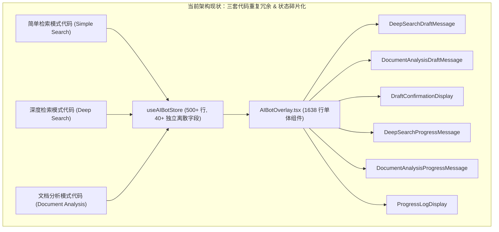
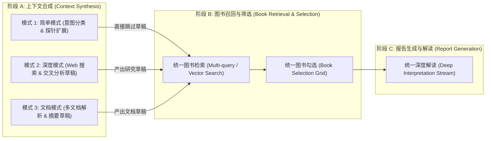

# AIBot 架构深度重构与模块化升级方案

> **文档状态**：待评审方案 / 技术架构蓝图  
> **目标模块**：`store/aibot/`、`components/aibot/`、`app/api/local-aibot/`  
> **核心目标**：消除三套模式（简单、深度、文档）的重复冗余，解耦 1600+ 行单体组件 `AIBotOverlay`，建立显式状态机与统一会话生命周期。

---

## 一、现状与核心技术痛点分析

当前 AIBot 拥有三种运行模式：
1. **简单模式（Simple/Text）**：用户输入 -> 问题分类 -> 图书检索 -> 用户选书 -> 生成解读
2. **深度模式（Deep Search）**：用户输入 -> 关键词生成 -> 网络搜索 -> 文章分析 -> 生成草稿 -> 草稿确认 -> 图书检索 -> 用户选书 -> 生成解读
3. **文档分析模式（Document）**：文档上传 -> 文档提取 -> 跨文档分析 -> 生成草稿 -> 草稿确认 -> 图书检索 -> 用户选书 -> 生成解读

### 1.1 现状架构四大核心债务



1. **三套工作流的高度克隆与冗余**：
   - 深度模式与文档模式的**后半段完全相同**：草稿确认（`draft-confirm`） $\rightarrow$ 图书检索（`book-search`） $\rightarrow$ 图书选择（`book-selection`） $\rightarrow$ 深度解读生成（`report-streaming`）。
   - 两套流各自在 Store 中定义了镜像字段（`deepSearch*` vs `documentAnalysis*`），并在 `AIBotOverlay.tsx` 中写了两遍几乎一样的 SSE 解析器、异常捕获、以及图书检索/解读调用代码。
2. **单体组件严重超载（`AIBotOverlay.tsx` 达 1638 行）**：
   - 组件既负责弹窗动画与模式切换，又当 SSE 数据流解析器，又直接调度 5 个不同的后端 API，还维护了大量局部状态。
   - 缺乏单一职责原则，任何改动都会引发意外副作用。
3. **状态双轨并行（Dual-track State）与脆弱的手动 Teardown**：
   - 一套是用字符串定义的阶段枚举（`RetrievalPhase`、`DeepSearchPhase`、`DocumentAnalysisPhase`）。
   - 另一套是漫天飞舞的布尔开关（`isStreaming`、`isDraftStreaming`、`isDraftComplete`、`isReportStreaming` 等）。
   - 关闭弹窗 [`closeOverlay()`](file:///d:/GITHUB/book-echoes-aibot/components/aibot/AIBotOverlay.tsx#L229-L246) 必须手动调用 10 个离散的 reset 函数。若某处异步 Promise 还在等待网络返回，关闭弹窗后仍会把数据推向 Store，引发「幽灵渲染」。
4. **UI 消息组件过度派生**：
   - `DeepSearchDraftMessage` 与 `DocumentAnalysisDraftMessage` 界面逻辑 95% 一致，却分成两个独立组件。
   - `DeepSearchProgressMessage` 与 `DocumentAnalysisProgressMessage` 同样是高度复制粘贴。

---

## 二、目标重构架构：统一管道与显式状态机

### 2.1 核心设计思想：统一图书智搜管线（Unified Intelligence Pipeline）

无论用户发起的是自然语言提问、深度研究主题，还是上传数篇文献，本质上都是**「上下文提炼 $\rightarrow$ 选书交互 $\rightarrow$ 深度解读」**的三部曲：



> **核心洞察**：
> 简单模式只是**「前置草稿阶段耗时为 0」**的特例；深度模式与文档模式只是**「前置草稿的数据源不同」**（一个是搜索引擎，一个是本地文件）。后半段的「图书检索 $\rightarrow$ 图书选定 $\rightarrow$ 流式解读」完全可以 100% 统一！

---

## 三、架构重构细则

### 3.1 状态模型收敛：统一有限状态机（Discriminated Union）

废弃所有分散的 `isStreaming`、`isDraftStreaming`、`isDraftComplete` 等独立布尔量，使用互斥的区分联合类型定义管线状态：

```ts
// types/aibot-pipeline.ts

export type PipelineSource = 'simple' | 'deep' | 'document';

export type PipelineProgressLog = {
    id: string;
    timestamp: string;
    phase: string;
    status: 'pending' | 'running' | 'completed' | 'error';
    message: string;
    details?: string;
};

export type PipelineState =
    | { status: 'idle' }
    | {
        status: 'analyzing';
        source: PipelineSource;
        logs: PipelineProgressLog[];
        currentPhase: string;
      }
    | {
        status: 'draft-review';
        source: 'deep' | 'document';
        userInput: string;
        draftMarkdown: string;
        metadata?: Record<string, unknown>; // 搜索 snippets 或文档列表
      }
    | {
        status: 'searching-books';
        source: PipelineSource;
        userInput: string;
        draftMarkdown?: string;
        logs: PipelineProgressLog[];
      }
    | {
        status: 'book-selection';
        source: PipelineSource;
        userInput: string;
        draftMarkdown?: string;
        books: BookInfo[];
        selectedBookIds: Set<string>;
      }
    | {
        status: 'interpreting';
        source: PipelineSource;
        selectedBooks: BookInfo[];
        reportMarkdown: string;
        logs: PipelineProgressLog[];
      }
    | {
        status: 'completed';
        source: PipelineSource;
        selectedBooks: BookInfo[];
        reportMarkdown: string;
      }
    | {
        status: 'error';
        source: PipelineSource;
        error: string;
        recoverableState?: PipelineState; // 支持一键重试回到上一步
      };
```

**消除不可能状态的收益**：
- 在 `analyzing` 时不可能出现 `selectedBooks`；
- 在 `book-selection` 时必然已有 `books: BookInfo[]`；
- `isStreaming` 不再需要手动维护，只要 `status === 'analyzing' || status === 'interpreting'` 即可自动推导。

---

### 3.2 强生命周期绑定：AbortController 中控器

在核心控制器 `useAIBotWorkflow` 中建立生命周期中枢：

```ts
// hooks/useAIBotWorkflow.ts
export function useAIBotWorkflow() {
    const abortRef = useRef<AbortController | null>(null);
    const [pipelineState, dispatch] = useReducer(pipelineReducer, { status: 'idle' });

    // 终止当前一切进行中的网络请求与流式读取
    const cancelOngoing = useCallback(() => {
        if (abortRef.current) {
            abortRef.current.abort();
            abortRef.current = null;
        }
    }, []);

    // 关闭弹窗或重置时：物理中断请求 + 状态原子归零
    const reset = useCallback(() => {
        cancelOngoing();
        dispatch({ type: 'RESET' });
    }, [cancelOngoing]);

    // 组件卸载自动销毁，彻底防范内存泄露与幽灵更新
    useEffect(() => {
        return () => cancelOngoing();
    }, [cancelOngoing]);

    return {
        state: pipelineState,
        startSimpleSearch,
        startDeepSearch,
        startDocumentAnalysis,
        confirmDraft,
        selectBooks,
        generateInterpretation,
        reset,
        cancelOngoing
    };
}
```

---

### 3.3 组件模块化拆分方案

将当前 1638 行的 `AIBotOverlay.tsx` 进行解耦拆分，形成清晰的四层架构：

```
components/aibot/
├── AIBotOverlay.tsx                 // 纯外层容器与弹窗动画 (< 200 行)
├── controllers/
│   ├── useAIBotWorkflow.ts          // 统一状态机管线控制器 (核心驱动)
│   └── useDocumentUpload.ts         // 文档选取与就绪状态管理
├── panels/
│   ├── AIBotHeader.tsx              // 模式切换与清空/关闭按钮
│   ├── AIBotInputBar.tsx            // 统一输入栏（自适应文字提交与文档上传触发）
│   └── DocumentUploadPanel.tsx      // 文档上传抽屉/拖拽区
└── messages/
    ├── MessageStream.tsx            // 消息流列表容器
    ├── UnifiedProgressMessage.tsx   // 统一进度条与日志展开组件 (替代原来的 3 套)
    ├── UnifiedDraftMessage.tsx      // 统一草稿确认与二次编辑组件 (替代原来的 2 套)
    ├── UnifiedBookSelection.tsx     // 统一图书多选与卡片网格 (替代原来的 2 套)
    └── UnifiedReportMessage.tsx     // 统一长文解读渲染 (集成 Markdown 与代码高亮)
```

---

## 四、实施迁移路线图（渐进式演进，拒绝破坏性大爆炸）

为确保生产环境稳定性，重构应采取**分步走策略（Strangler Fig Pattern）**：

| 阶段 | 任务目标 | 核心工作 | 风险控制 |
|---|---|---|---|
| **Phase 1: 组件归一** | 消除 UI 层重复度 | 1. 抽取通用的 `UnifiedProgressMessage` 与 `UnifiedDraftMessage`<br>2. 深度检索与文档分析复用同一套 UI 展示组件 | 不改动底层 API 与核心流程，低风险 |
| **Phase 2: 状态机封装** | 抽象管线控制器 | 1. 编写 `pipelineReducer` 与 `useAIBotWorkflow`<br>2. 统一管理 `AbortController` 与 SSE 流处理<br>3. 编写状态迁移与重试单元测试 | 在独立 feature 分支完整验证三种模式 |
| **Phase 3: 容器瘦身** | 瘦身 `AIBotOverlay` | 1. `AIBotOverlay.tsx` 切换为挂载 `useAIBotWorkflow`<br>2. 移除原 1600 行组件内的冗余函数与死代码<br>3. 代码量从 1638 行下降至 200 行以内 | 保留端到端体验一致 |
| **Phase 4: Store 瘦身** | 清理全局技术债务 | 1. 从 `useAIBotStore` 中清理已被内部状态机接管的 30+ 废弃字段<br>2. Store 仅保留全局配置、历史记录与模态框开启状态 | 彻底消灭技术债务 |

---

## 五、验收标准

1. **代码行数指标**：`AIBotOverlay.tsx` 缩减至 250 行以内；AIBot 前端相关代码总体精简 40% 以上。
2. **状态纯净度**：除输入框文字与弹窗展开态外，零散孤立布尔量（`is*Streaming`、`is*Complete`）清零，由统一 Pipeline 状态驱动。
3. **健壮性验证**：在流式输出、草稿生成、图书检索任意阶段关闭弹窗或点击清空，控制台无任何 React 状态泄露警告或未捕获的 Promise 报错（通过 AbortController 拦截）。
